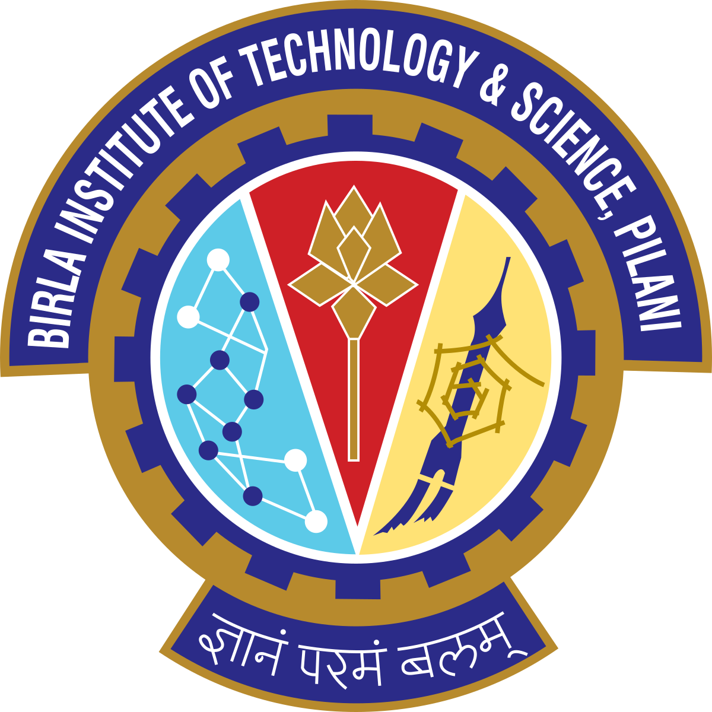

## Work Experience
<table>
    <thead>
        <tr>
            <th>Company</th>
            <th>Link</th>
            <th>Role</th>
            <th>Dates</th>
            <th>Location</th>
        </tr>
    </thead>
    <tbody>
        <tr>
            <td rowspan=3></td>
            <td rowspan=3><a href="https://www.alpha-sense.com/" target="_blank">Alpha sense</a></td>
        </tr>
        <tr>
            <td>Software Engineer 2</td>
            <td>1/2024 - 8/2024</td>
            <td>Full Remote   New Delhi, India</td>
        </tr>
        <tr>
            <td>Software Engineer</td>
            <td>6/2022 - 1/2024</td>
            <td>Full Remote   New Delhi, India</td>
        </tr>
        <tr>
            <td></td>
            <td><a href="https://in.linkedin.com/company/sentieo" target="_blank">Sentieo</a></td>
            <td>Software Engineer Intern</td>
            <td>1/2022 - 6/2022</td>
            <td>Full Remote   New Delhi, India</td>
        </tr>
    </tbody>
</table>

## Education
<table>
    <thead>
        <tr>
            <th>School</th>
            <th>Link</th>
            <th>Degree</th>
            <th>Date</th>
        </tr>
    </thead>
    <tbody>
        <tr>
            <td rowspan=4></td>
            <td rowspan=4>
                <a href="https://www.bits-pilani.ac.in/" target="_blank">
                    Birla Institute of Technology and Science, Pilani
                </a>
            </td>
        </tr>
        <tr>
            <td>B.E Electrical and Electronics</td>
            <td>2022</td>
        </tr>
         <tr>
            <td>M.Sc in Economics</td>
            <td>2022</td>
        </tr>
    </tbody>
</table>

## Skills


 Database Management System 
 Operating System 
 Computer Networking 
 Object Oriented Programming 
 Cloud Computing 
 Microservices 
 Distributed Systems 
